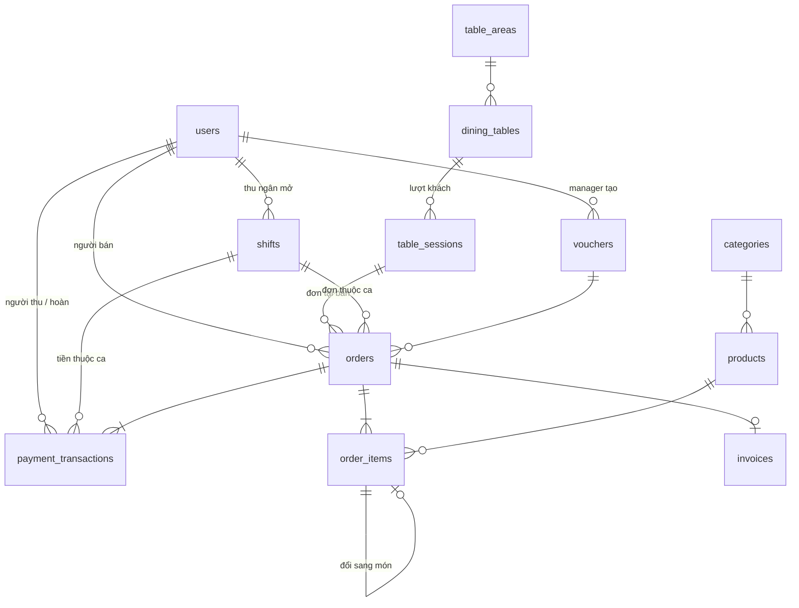

# Thiết kế database SmartCoffee (luồng thanh toán trước, pha sau)

> **Trạng thái: ĐỀ XUẤT, CHỜ PM DUYỆT.** Chưa viết SQL. Chỉ Hùng được duyệt thay đổi schema (D-22).
> Phiên bản 0.1, ngày 17/11/2026. Thay cho `database/smartcoffee_pos.sql` (thiết kế cho luồng cũ, D-23; đã xóa khỏi `main` ngày 17/11). Script: [`database/smartcoffee_v2.sql`](../database/smartcoffee_v2.sql).

Ký hiệu nguồn ở mỗi mục:
- **[D-xx]**: quyết định PM đã chốt trong `docs/business-rules.md`.
- **[P-xx]**: nội dung đang chờ PM duyệt (business-rules mục 3). Duyệt bản thiết kế này nghĩa là duyệt luôn các P được dùng.
- **[ĐX]**: đề xuất kỹ thuật của AI, PM có thể đổi.

## 1. Nguyên tắc chung

- MariaDB 10.4 (XAMPP), InnoDB, `utf8mb4`.
- Tiền VND lưu số nguyên `INT UNSIGNED`, không có số lẻ [P-12].
- Mọi khóa chính là `id INT UNSIGNED AUTO_INCREMENT`.
- Không xóa dữ liệu nghiệp vụ (đơn, món, giao dịch). Hủy là đổi trạng thái kèm người và lý do [D-29].
- Thời gian lưu `DATETIME` giờ Việt Nam [ĐX].
- Ràng buộc nào database kiểm được thì đặt trong database (khóa ngoại, CHECK, UNIQUE). Phần còn lại code kiểm (mục 5).

## 2. Sơ đồ quan hệ

## 3. Các bảng

### 3.1 `store_settings` (giữ như SQL cũ)
Một dòng duy nhất: tên quán, địa chỉ, điện thoại, wifi, lời chào cuối hóa đơn. Dùng in hóa đơn [P-11].

### 3.2 `users`
| Cột | Kiểu | Ghi chú |
|---|---|---|
| username | VARCHAR(50) UNIQUE | Tên đăng nhập |
| password_hash | VARCHAR(255) | `password_hash()` của PHP |
| full_name | VARCHAR(100) | |
| staff_code | VARCHAR(20) UNIQUE | Mã nhân viên, in trong tổng kết ca để biết phục vụ nào thu [D-33] |
| role | ENUM('admin','manager','cashier','waiter','barista') | Cố định trong code [D-03, D-14]. Không có vai trò chủ quán [D-35] |
| is_active | TINYINT(1) | Khóa tài khoản thay vì xóa |
| created_at, updated_at | DATETIME | |

Admin tạo tài khoản, không có đăng ký [P-02]. Vai trò lấy theo tài khoản, màn đăng nhập không chọn vai trò [P-03].

### 3.3 `categories`
`name`, `sort_order`, `is_active`. Ví dụ: Cà phê, Trà.

### 3.4 `products`
| Cột | Kiểu | Ghi chú |
|---|---|---|
| category_id | FK categories | |
| name | VARCHAR(100) | |
| price | INT UNSIGNED | Giá hiện tại |
| description | VARCHAR(255) NULL | |
| image_path | VARCHAR(255) NULL | |
| status | ENUM('available','sold_out','discontinued') | Đang bán / Tạm hết / Ngừng bán [D-58] |
| has_sweetness, has_bitterness, has_ice | TINYINT(1) | Món có cho tùy chỉnh ngọt, đắng, đá không (trà không có đắng) [ĐX] |

### 3.5 `table_areas` (mới) [ĐX]
`name`, `sort_order`. Ví dụ: Tầng trệt, Sân vườn, Lầu 1. Là các tab khu vực trên sơ đồ bàn POS v2.

### 3.6 `dining_tables`
| Cột | Kiểu | Ghi chú |
|---|---|---|
| area_id | FK table_areas | |
| code | VARCHAR(10) UNIQUE | B01, V01, L01 |
| sort_order | SMALLINT | Thứ tự trên sơ đồ |
| is_active | TINYINT(1) | |

Không có cột trạng thái. **Bàn "Có khách" khi có một lượt khách đang mở** ở bảng 3.7, nên không bao giờ lệch giữa hai nơi [ĐX]. Không lưu số khách [D-10].

### 3.7 `table_sessions` (mới): lượt khách ngồi bàn [ĐX]
Cần để biết **đơn nào thuộc lượt khách hiện tại** của bàn. Không có bảng này thì sau khi Trả bàn, đơn cũ và đơn của khách mới lẫn vào nhau.

| Cột | Kiểu | Ghi chú |
|---|---|---|
| table_id | FK dining_tables | |
| started_at | DATETIME | Lúc đơn đầu tiên của lượt thanh toán xong [D-31] |
| started_by | FK users | |
| ended_at | DATETIME NULL | Lúc phục vụ bấm Trả bàn [D-41, D-51] |
| ended_by | FK users NULL | |
| open_table_id | sinh tự động: `table_id` khi `ended_at IS NULL` | UNIQUE: **mỗi bàn tối đa một lượt đang mở** |

### 3.8 `shifts` (mới): ca thu ngân
| Cột | Kiểu | Ghi chú |
|---|---|---|
| code | VARCHAR(20) UNIQUE | Ví dụ CA1611-01 [ĐX] |
| cashier_id | FK users | Một ca một thu ngân [D-37] |
| status | ENUM('open','closed') | |
| opened_at | DATETIME | Thu ngân tự mở [D-47] |
| opening_cash | INT UNSIGNED | Tiền mặt đầu ca [D-32] |
| closed_at | DATETIME NULL | |
| closing_cash_counted | INT UNSIGNED NULL | Tiền mặt đếm được lúc kết ca [D-32] |
| expected_cash | INT UNSIGNED NULL | Hệ thống tính lúc kết ca, lưu lại để không đổi về sau [ĐX] |
| open_flag | sinh tự động: 1 khi `status='open'` | UNIQUE: **toàn hệ thống chỉ một ca mở** [D-47] |

`expected_cash = opening_cash + tiền mặt thu (payment, extra_charge) − tiền mặt hoàn (refund)` trong ca.

### 3.9 `vouchers` (mới)
| Cột | Kiểu | Ghi chú |
|---|---|---|
| code | VARCHAR(30) UNIQUE | Ví dụ CAFE5 |
| discount_type | ENUM('percent','amount') | [D-48] |
| discount_value | INT UNSIGNED | Percent: 1 đến 100 (CHECK). Amount: số tiền |
| expires_at | DATETIME | Hạn dùng [D-48] |
| usage_limit | INT UNSIGNED | Số lần dùng tối đa [D-48] |
| used_count | INT UNSIGNED | CHECK `used_count <= usage_limit` |
| is_active | TINYINT(1) | Manager tắt voucher mà không xóa |
| created_by | FK users | Manager [D-43] |
| created_at | DATETIME | |

Không có trần giảm, không có điều kiện đơn tối thiểu [D-57].

### 3.10 `orders`
**Đơn chỉ được tạo khi thanh toán xong**, trong một giao dịch cùng món và tiền [D-25, D-26]. Không có đơn nháp, không có trạng thái "đang mở".

| Cột | Kiểu | Ghi chú |
|---|---|---|
| code | VARCHAR(20) UNIQUE | Ví dụ SC-1611-001, hệ thống sinh [D-11] |
| order_type | ENUM('dine_in','takeaway') | Thu ngân bán `takeaway`, phục vụ bán `dine_in` [D-54, D-55, D-61] |
| table_session_id | FK table_sessions NULL | NULL khi mang đi [D-55] |
| shift_id | FK shifts NOT NULL | Không có ca thì không có đơn [D-38] |
| created_by | FK users | Người bán: phục vụ hoặc thu ngân |
| status | ENUM('paid','cancelled') | |
| subtotal | INT UNSIGNED | Tổng tiền món lúc thanh toán |
| voucher_id | FK vouchers NULL | Tối đa một voucher [D-57] |
| discount | INT UNSIGNED | Số tiền giảm |
| total | INT UNSIGNED | CHECK `total + discount = subtotal` |
| paid_at | DATETIME | |
| cancelled_by, cancelled_at, cancel_reason | NULL | CHECK: có đủ khi `status='cancelled'` [D-35] |

CHECK: `dine_in` thì có `table_session_id`; `takeaway` thì không.
`subtotal`, `discount`, `total` giữ số lúc thanh toán. **Số tiền thực tế của đơn sau hủy món, đổi món là tổng các giao dịch ở bảng 3.12.**

Chuyển bàn, gộp bàn: đổi `table_session_id` của các đơn sang lượt khách của bàn đích, đóng lượt của bàn cũ. Các đơn vẫn riêng [D-34, D-42, D-53].

### 3.11 `order_items`
Mỗi dòng là một món với một bộ tùy chỉnh [P-08].

| Cột | Kiểu | Ghi chú |
|---|---|---|
| order_id | FK orders | |
| product_id | FK products | |
| product_name | VARCHAR(100) | Chép tên lúc bán, đổi tên món sau này không ảnh hưởng hóa đơn cũ [ĐX] |
| unit_price | INT UNSIGNED | Giá lúc bán [P-08] |
| quantity | SMALLINT UNSIGNED | CHECK > 0 |
| sweetness, bitterness | ENUM('less','normal','more') NULL | [D-56] |
| ice | ENUM('none','less','normal','more') NULL | [D-56] |
| note | VARCHAR(255) NULL | Ghi chú tự do |
| status | ENUM('waiting','preparing','done','served','cancelled','replaced') | Chờ → Đang pha → Xong → Đã mang ra [P-06]; Đã hủy; Đổi món [D-29] |
| replaces_item_id | FK order_items NULL | Món mới trong lần đổi món trỏ về món cũ [D-36] |
| prepared_by | FK users NULL | Pha chế bấm Xong [D-12] |
| served_by, served_at | NULL | Phục vụ bấm Đã mang ra [P-01] |
| cancelled_by, cancelled_at, cancel_reason | NULL | Dùng chung cho Đã hủy và Đổi món. CHECK: có đủ khi status là `cancelled` hoặc `replaced` [D-29] |
| created_at, updated_at | DATETIME | |

Hàng chờ pha chế lấy món `waiting` và `preparing`, cũ trước [P-07]. Chỉ mục `(status, created_at)`.

### 3.12 `payment_transactions` (thay `payments`): sổ thu chi
Mỗi lần tiền đi vào hoặc đi ra là một dòng. Đây là chỗ trả lời "ca này thu bao nhiêu, ai thu, hoàn bao nhiêu".

| Cột | Kiểu | Ghi chú |
|---|---|---|
| order_id | FK orders | |
| shift_id | FK shifts | **Luôn bằng ca của đơn** [D-49, D-52] |
| type | ENUM('payment','extra_charge','refund') | Thu lần đầu / thu thêm khi đổi món / hoàn [D-29, D-36, D-50] |
| method | ENUM('cash','transfer') | Không có thẻ [D-39] |
| amount | INT UNSIGNED | CHECK > 0 |
| received_amount | INT UNSIGNED NULL | Tiền khách đưa (tiền mặt), để tính tiền thối [P-10] |
| order_item_id | FK order_items NULL | Món liên quan khi hoàn hoặc thu thêm |
| handled_by | FK users | Ai thu hoặc ai hoàn [D-33] |
| reason | VARCHAR(255) NULL | Bắt buộc với `refund`, `extra_charge` (CHECK) |
| created_at | DATETIME | |

UNIQUE: mỗi đơn đúng một dòng `payment`, nên mỗi đơn một phương thức [D-40]. Dòng `refund`, `extra_charge` ghi phương thức thực tế, có thể khác dòng `payment` [D-62].

### 3.13 `invoices`
Giữ như SQL cũ: `order_id` UNIQUE, `invoice_no`, `total`, `issued_by`, `issued_at`, `print_count`; thêm `last_printed_at` [P-11, ĐX].

## 4. So với `smartcoffee_pos.sql` cũ

| Bảng | Thay đổi |
|---|---|
| users | Thêm `staff_code` |
| products | `status` có 3 giá trị; thêm 3 cờ tùy chỉnh |
| dining_tables | Bỏ trạng thái lưu tay; thêm `area_id` |
| orders | Bỏ `open`, bỏ khóa "mỗi bàn một đơn mở"; thêm `shift_id`, `voucher_id`, `table_session_id` |
| order_items | Bỏ `draft`, `ready`; thêm `done`, `replaced`, ngọt/đắng/đá, `replaces_item_id` |
| payments | Thay bằng `payment_transactions`; bỏ `card` |
| Mới | `table_areas`, `table_sessions`, `shifts`, `vouchers` |

## 5. Quy tắc code phải kiểm (database không kiểm được)

| Quy tắc | Nguồn |
|---|---|
| Không có ca mở thì phục vụ và thu ngân không tạo đơn được | D-38 |
| Phục vụ chỉ bán `dine_in`; thu ngân chỉ bán `takeaway` | D-54, D-55, D-61 |
| Manager và admin không tạo đơn, không thu tiền | D-04, D-44 |
| Chỉ manager hủy món, đổi món, hủy đơn; bắt buộc lý do | D-06, D-29, D-35 |
| Hủy món, đổi món, hủy đơn chỉ khi ca của đơn còn mở | D-52 |
| Hủy cả đơn: hoàn đúng số tiền thực tế còn lại của đơn | D-50 |
| Hủy, đổi một món trong đơn có voucher: tính theo giá món sau giảm. Tiền giảm của đơn chia cho các món theo tỷ lệ thành tiền, làm tròn đồng, phần lẻ dồn vào món cuối [ĐX] | D-60 |
| Voucher: còn hạn, còn lượt, đang bật; tăng `used_count` trong cùng giao dịch tạo đơn | D-48, D-57 |
| Món Tạm hết, Ngừng bán không bán được | D-58 |
| Trạng thái món chỉ đi tới theo thứ tự Chờ → Đang pha → Xong → Đã mang ra | P-06 |
| Tạo đơn, món, giao dịch, lượt bàn trong **một transaction**; lỗi thì không lưu gì | ĐX |

## 6. Luồng dữ liệu các thao tác chính

- **Phục vụ bán tại bàn:** kiểm ca mở → nếu bàn chưa có lượt mở thì tạo `table_sessions` → tạo `orders` (paid) → `order_items` (waiting) → `payment_transactions` (payment, `handled_by` = phục vụ) → tăng `vouchers.used_count` nếu có.
- **Thu ngân bán mang đi:** như trên, `order_type = takeaway`, không có lượt bàn.
- **Pha chế:** đổi `order_items.status` waiting → preparing → done.
- **Phục vụ mang ra:** done → served.
- **Trả bàn:** đóng `table_sessions` (`ended_at`). Không kiểm điều kiện [D-51].
- **Chuyển / gộp bàn:** đơn của lượt cũ chuyển sang lượt đang mở của bàn đích (tạo nếu bàn đích trống); đóng lượt cũ [D-34, D-42, D-53].
- **Hủy món:** món → `cancelled` + lý do; thêm `refund` [D-29, D-30].
- **Đổi món:** món cũ → `replaced` + lý do; thêm món mới có `replaces_item_id`; thêm `extra_charge` hoặc `refund` phần chênh lệch [D-36].
- **Hủy cả đơn:** `orders.status = cancelled`; các món chưa hủy → `cancelled`; thêm `refund` bằng số tiền thực tế còn lại [D-50].
- **Mở ca / kết ca:** tạo `shifts` (open); kết ca thì tính `expected_cash`, lưu `closing_cash_counted`, đổi sang `closed`.

## 7. Câu hỏi mở

Không còn. Q-09, Q-10, Q-11 đã chốt ngày 17/11 (D-60, D-61, D-62).

## 8. Bước tiếp theo

1. PM đọc và duyệt (hoặc sửa) bản này.
2. Viết `database/smartcoffee_v2.sql` (giữ file cũ để đối chiếu) kèm dữ liệu mẫu khớp POS v2.
3. Import vào XAMPP, chạy thử các luồng ở mục 6 bằng SQL.
4. Cập nhật `docs/api-contract.md` mục schema.
